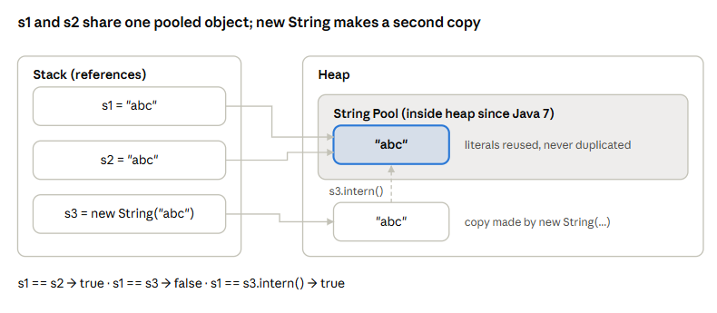

# Java Interview Questions

## 1. JDK, JRE, and JVM are three important components of Java.

- JDK (Java Development Kit): Used to develop, compile, and run Java applications. It includes development tools like javac, java, and javadoc.
- JRE (Java Runtime Environment): Provides the environment required to run Java applications. It includes the JVM and supporting libraries.
- JVM (Java Virtual Machine): Executes Java bytecode and provides platform independence. It also handles memory management and garbage collection.

## 2. How a Java program runs

javac compiles .java source into bytecode in .class files. Then the JVM loads, verifies, and runs that bytecode.

- javac turns Hello.java into Hello.class (bytecode, not machine code).
- java Hello starts the JVM.
- The class loader loads the class (bootstrap, platform, then application loaders).
- The bytecode verifier checks the code is safe.
- The execution engine runs it, using an interpreter and a JIT compiler.

## 3. Interpreter vs JIT Compiler
Interpreter and JIT (Just-In-Time) Compiler are two mechanisms used by the JVM to execute Java bytecode.

- Interpreter: Executes Java bytecode instruction by instruction. It starts execution quickly but is generally slower for repeatedly executed code.

- JIT Compiler: Converts frequently executed bytecode into native machine code at runtime, improving performance.

> "In Java, the Interpreter and JIT Compiler are part of JVM execution.
>
> The Interpreter executes bytecode instruction by instruction.
>
> The JIT Compiler identifies frequently executed code and compiles it into machine code.
>
> So, the Interpreter helps with quick startup, while the JIT Compiler improves execution speed."

## 4. Primitive vs Non-primitive
### 1. Primitive Data Types

Primitive data types are the basic built-in data types in Java.

Java has **8 primitive data types**:

| Data Type | Size | Range |
|-----------|------|-------|
| `byte` | 1 byte (8 bits) | -128 to 127 |
| `short` | 2 bytes (16 bits) | -32,768 to 32,767 |
| `int` | 4 bytes (32 bits) | -2³¹ to 2³¹ - 1 |
| `long` | 8 bytes (64 bits) | -2⁶³ to 2⁶³ - 1 |
| `float` | 4 bytes (32 bits) | Approx. ±3.4 × 10³⁸ |
| `double` | 8 bytes (64 bits) | Approx. ±1.8 × 10³⁰⁸ |
| `char` | 2 bytes (16 bits) | 0 to 65,535 (`'\u0000'` to `'\uffff'`) |
| `boolean` | JVM-dependent storage | `true` or `false` |

### Key Points

- Store simple values directly.
- Have fixed sizes (except boolean, whose size is not precisely defined).
- Cannot call methods directly on primitive values.
- Generally use less memory than objects.


### 2. Non-Primitive Data Types

Non-primitive data types are also called **Reference Data Types**.

They refer to objects or arrays rather than directly containing primitive values.

### Examples

- String
- Array
- Class
- Object
- Interface
- Enum

### Key Points

- Variables store references to objects or arrays.
- Can have methods and properties depending on the type.
- Can hold `null`.
- Objects are generally allocated on the heap.

### 3. Primitive vs Non-Primitive

| Primitive | Non-Primitive |
|-----------|---------------|
| Stores actual value | Stores a reference |
| 8 built-in types | Many reference types |
| Cannot be null | Can be null |
| Cannot call methods directly | Can access methods |
| Examples: int, char | Examples: String, Array |

> "In Java, data types are divided into two categories: Primitive and Non-Primitive.
>
> Primitive data types store simple values directly. Java has eight primitive types, such as int, double, char, and boolean.
>
> Non-Primitive data types are reference types, such as String, Array, and Class. They store references to objects or arrays and can have methods.
>
> The main difference is that primitive variables hold actual values, while non-primitive variables hold references to objects."

## 5. Wrapper Class , Autoboxing & Unboxing
Wrapper classes are objects that hold primitive values (Integer, Long, Double, Character, Boolean, and so on). Autoboxing and unboxing convert between the two automatically.

> Autoboxing: Integer x = 5; becomes Integer.valueOf(5).
>
> Unboxing: int y = x; becomes x.intValue().
>
> Use wrappers for generics (List<Integer>) because generics only accept objects.   
>
> Wrappers can be null. Unboxing null throws NullPointerException.


## 6. Integer Cache
Integer.valueOf() reuses cached objects for values from -128 to 127. So == returns true in that range but false outside it, because it compares references.

```java
Integer a = 127, b = 127;
System.out.println(a == b);       // true  (same cached object)

Integer c = 128, d = 128;
System.out.println(c == d);       // false (different objects)
System.out.println(c.equals(d));  // true  (compares values)
```

- Always compare wrapper values with equals().
- Byte, Short, Long, and Character (0 to 127) also cache values. Float and Double never cache.
- The upper limit of the Integer cache can be raised with `-XX:AutoBoxCacheMax=<n>`.
- new Integer(...) is deprecated. Use Integer.valueOf() or autoboxing.

> Likely follow-up: “Why use the cache?” It saves memory and allocation time for common small values.   


## 7. String pool at a glance

String literals go into the String Pool, a special area inside the heap (moved from PermGen to the main heap in Java 7). Same literal = same object. new always makes a fresh object outside the pool.
```java
String s1 = "abc";
String s2 = "abc";              // reuses pooled object
String s3 = new String("abc");   // new heap object

s1 == s2           // true  (same object)
s1 == s3           // false (different objects)
s1.equals(s3)      // true  (same content)
s1 == s3.intern()  // true  (intern returns the pooled one)
```


Two literals point to the same pooled object; new creates a separate heap copy, and intern() leads back to the pooled one.

## 8. Why String is immutable — 4 reasons

1. `Security` — Strings carry file paths, URLs, DB usernames/passwords and class names for class loading. If a String could change after a security check, someone could swap the value (e.g. check /safe/file, then change it to /etc/passwd).

2. `Caching hashCode` — String stores its hash in a field after the first hashCode() call. Since the value never changes, the hash never changes. This is why String is the best HashMap key: if a key could mutate, its hash would change and the entry would be lost in the wrong bucket.

3. `Thread safety` — An immutable object can be shared by many threads with no synchronized and no risk of one thread seeing half-changed data.

4. `String pool` — The pool only works because Strings can't change. If s1 could modify the shared "abc", then s2 (and every other reference to it) would also change silently.

## 9. How many objects does new String("abc") create?

**Up to 2.**
- One "abc" in the String Pool — for the literal. Created only if the pool doesn't already have it (it's added when the class is loaded/the literal is first resolved).
- One new String object on the heap — always, because of new.

`So`: pool empty → 2 objects; pool already has "abc" → 1 new object.
StringBuilder vs StringBuffer

| Feature | StringBuilder | StringBuffer |
|---|---|---|
| Mutable? | Yes | Yes |
| Thread-safe? | No | Yes (methods are synchronized) |
| Speed | Faster | Slower (locking cost) |
| Since | Java 5 | Java 1.0 |
| Use when | Default choice, single thread (almost always) | Same buffer truly shared across threads (rare) |

> Why not just `+` in a loop? 
>
> Each `+` on a String creates a new object, so building a string in a loop with `+` makes many throwaway objects. Use StringBuilder.append() instead.

## 10. What is String.intern()?

`intern()` returns the pooled (canonical) copy of a string.
- If the pool already has an equal string → returns that pooled reference.
- If not → adds this string to the pool (Java 7+ stores a reference to the existing heap object) and returns it.

```java
String a = new String("hello");
String b = a.intern();
b == "hello"   // true
a == b         // false (a is still the heap copy)
```
*Use case*: saving memory when you have many duplicate strings (e.g. repeated values read from a file). Rarely needed in day-to-day code — don't overuse it.

>String is immutable for security, hashCode caching, thread safety and to make the String Pool possible. new String("abc") creates up to two objects — one in the pool, one on the heap. StringBuilder is fast and not thread-safe; StringBuffer is synchronized and slower. intern() returns the pooled copy of a string.

## Q11. How are negative numbers stored in Java?

### Short answer (say this first in the interview)
> Java stores negative integers using **Two's Complement**. All integer types (`byte`, `short`, `int`, `long`) are **signed**, and the **leftmost bit (MSB)** is the sign bit: `0` = positive, `1` = negative.

### How to get Two's Complement (3 steps)
1. Write the positive number in binary.
2. **Invert** all bits (0 → 1, 1 → 0). This is called One's Complement.
3. **Add 1**.

### Example: store `-5` in a `byte` (8 bits)

| Step | Binary |
|------|--------|
| `+5` in binary | `0000 0101` |
| Invert bits | `1111 1010` |
| Add 1 | `1111 1011` ← this is **-5** |

As an `int` (32 bits), `-5` is:
```
11111111 11111111 11111111 11111011
```

Check it in code:
```java
System.out.println(Integer.toBinaryString(-5));
// 11111111111111111111111111111011
```

### Why Java uses Two's Complement (common follow-up)
- **Only one zero.** In sign-magnitude, there would be `+0` and `-0`. Two's complement has a single `0`.
- **Same hardware for add and subtract.** `a - b` is just `a + (-b)`. The CPU does not need separate logic.
- **No special handling of the sign** during addition.

### Range of integer types

| Type | Size | Range |
|------|------|-------|
| `byte` | 8 bits | -128 to 127 |
| `short` | 16 bits | -32,768 to 32,767 |
| `int` | 32 bits | -2³¹ to 2³¹ - 1 (≈ -2.1 billion to 2.1 billion) |
| `long` | 64 bits | -2⁶³ to 2⁶³ - 1 |

Notice: the negative side has **one extra value**. That's because `0` uses one of the "positive" patterns.

### Tricky follow-up questions

**1. What is `Integer.MAX_VALUE + 1`?**
```java
System.out.println(Integer.MAX_VALUE + 1); // -2147483648 (Integer.MIN_VALUE)
```
Overflow wraps around. Java does **not** throw an error. (Use `Math.addExact()` if you want an exception.)

**2. What is `Math.abs(Integer.MIN_VALUE)`?**
```java
System.out.println(Math.abs(Integer.MIN_VALUE)); // -2147483648 (still negative!)
```
Because `+2147483648` does not fit in an `int`.

**3. `(byte) 200` gives what?**
```java
System.out.println((byte) 200); // -56
```
`200` = `1100 1000`. MSB is 1, so as a byte it is read as negative → 200 - 256 = **-56**.

**4. Difference between `>>` and `>>>`?**
- `>>` (signed right shift) keeps the sign bit → negative stays negative.
- `>>>` (unsigned right shift) fills with `0` → result becomes positive.
```java
System.out.println(-8 >> 1);   // -4
System.out.println(-8 >>> 1);  // 2147483644
```

**5. Does Java have unsigned int?**
No primitive `unsigned int`. `char` (16-bit) is the only unsigned primitive. Since Java 8, you can use helper methods like `Integer.toUnsignedString()` and `Integer.divideUnsigned()`.

---

## Q12. How are float values stored in memory?

### Short answer (say this first)
> Java stores `float` and `double` using the **IEEE 754** standard. The number is stored like scientific notation in binary:
> **value = (-1)^sign × 1.mantissa × 2^(exponent - bias)**

### Bit layout

| Type | Total | Sign | Exponent | Mantissa (fraction) | Bias | Precision |
|------|-------|------|----------|---------------------|------|-----------|
| `float` | 32 bits | 1 | 8 | 23 | 127 | ~6–7 decimal digits |
| `double` | 64 bits | 1 | 11 | 52 | 1023 | ~15–16 decimal digits |

```
float:  [S][EEEEEEEE][MMMMMMMMMMMMMMMMMMMMMMM]
         1     8               23
```

- **Sign (S):** `0` = positive, `1` = negative. (Floats do **not** use two's complement.)
- **Exponent:** stored with a **bias** (127 for float), so negative exponents can be stored without a sign bit.
- **Mantissa:** the digits after the point. The leading `1.` is **not stored** (called the "hidden bit"), which saves 1 bit.

### Example: store `5.75f`

**Step 1 – Convert to binary**
- `5` = `101`
- `.75` = `.11`
- So `5.75` = `101.11`

**Step 2 – Normalize (move point after the first 1)**
- `101.11` = `1.0111 × 2²`

**Step 3 – Fill the 3 parts**
- Sign = `0` (positive) 
- Bias = `127` (2 ^ (exponent - 1) - 1)
- Exponent = 2 + 127 = **129** = `10000001`
- Mantissa = `0111` followed by zeros = `01110000000000000000000`

**Result:**
```
0 10000001 01110000000000000000000
= 0x40B80000
```

Verify in Java:
```java
System.out.println(Integer.toHexString(Float.floatToIntBits(5.75f))); // 40b80000
```

For `-5.75f`, only the sign bit changes to `1` → `0xC0B80000`.

### Special values

| Value | Exponent bits | Mantissa bits |
|-------|---------------|---------------|
| `0.0` / `-0.0` | all 0 | all 0 |
| `Infinity` / `-Infinity` | all 1 | all 0 |
| `NaN` | all 1 | not all 0 |
| Very tiny numbers (denormal) | all 0 | not all 0 |

```java
System.out.println(1.0 / 0);        // Infinity
System.out.println(0.0 / 0);        // NaN
System.out.println(Double.NaN == Double.NaN); // false
System.out.println(0.0 == -0.0);    // true
```

### Tricky follow-up questions

**1. Why is `0.1 + 0.2 != 0.3`?**
```java
System.out.println(0.1 + 0.2);        // 0.30000000000000004
System.out.println(0.1 + 0.2 == 0.3); // false
```
`0.1` in binary is a **repeating fraction** (like 1/3 in decimal = 0.333...). It can't be stored exactly, so a tiny rounding error appears.

**2. How do you compare two floats/doubles safely?**
Use a small tolerance (epsilon):
```java
Math.abs(a - b) < 1e-9
```
Or use `Double.compare(a, b)`.

**3. Should you use `float`/`double` for money?**
**No.** For ₹ amounts (prices, salaries, bank balance), use `BigDecimal`, created from a **String**:
```java
BigDecimal a = new BigDecimal("0.1");
BigDecimal b = new BigDecimal("0.2");
System.out.println(a.add(b)); // 0.3
```
`new BigDecimal(0.1)` (from double) still carries the error. Always use the String constructor or `BigDecimal.valueOf()`.

**4. Why do we write `f` in `float x = 3.14f;`?**
A decimal literal is `double` by default. Without `f`, it's a compile error (possible lossy conversion from double to float).

**5. Can a `float` hold every `int` value exactly?**
No. `float` has only 24 bits of precision (23 + hidden bit). Integers above 2²⁴ (16,777,216) may lose accuracy.
```java
System.out.println((float) 16777217); // 1.6777216E7
```

---

## Quick Revision Table

| Point | Integers (negative) | float / double |
|-------|---------------------|----------------|
| Standard | Two's complement | IEEE 754 |
| Sign | MSB, part of the value | Separate sign bit |
| Exact? | Yes (within range) | Not always (rounding) |
| Overflow | Wraps around silently | Becomes `Infinity` |
| Divide by 0 | `ArithmeticException` | `Infinity` or `NaN` |
| Number of zeros | One | Two (`+0.0`, `-0.0`) |

---

## 30-second interview answer

> "In Java, negative integers are stored using two's complement: you invert the bits of the positive number and add 1. The MSB acts as the sign bit. It's used because there's only one zero and addition/subtraction use the same hardware.
>
> Float and double follow IEEE 754. A float is 32 bits: 1 sign bit, 8 exponent bits with a bias of 127, and 23 mantissa bits with a hidden leading 1. Double is 64 bits: 1, 11, 52 with a bias of 1023. Because many decimals like 0.1 can't be represented exactly in binary, we get rounding errors, so for money we use BigDecimal."


## Q13. What is the difference between a Class and an Object?

**Answer:**
- **Class:** A blueprint or template used to create objects.
- **Object:** An instance of a class that has state and behavior.

**Example:**

```java
class Student {
    String name;
    int age;
}

public class Main {
    public static void main(String[] args) {
        Student s1 = new Student();
    }
}
```

Here, `Student` is the class, and `s1` refers to an object of that class.

## Q14. What is the difference between Procedural Programming and Object-Oriented Programming?

**Answer:**

| Procedural Programming | Object-Oriented Programming |
|---|---|
| Focuses on functions and procedures | Focuses on classes and objects |
| Data and functions are generally separate | Groups related data and methods in classes |
| Example: C | Example: Java |
| Organizes code around procedures | Organizes code around objects |

**Interview-ready answer:** OOP helps organize large applications by combining related data and behavior into objects, supporting modularity, reusability, and maintainability.

## Q15. What are the three main characteristics of an Object?

**Answer:**

1. **State:** The data or properties of an object, such as a student's name and age.
2. **Behavior:** Actions an object can perform, such as `study()`.
3. **Identity:** What distinguishes one object from another, even if their state is the same.

**Example:**

```java
class Student {
    String name = "Rahul"; // State

    void study() {         // Behavior
        System.out.println("Studying");
    }
}
```

Two `Student` objects can have the same name but still be distinct objects with different identities.

---

### Bonus: Common Follow-Up Question

**What is the difference between `Student s1;` and `Student s1 = new Student();`?**

- `Student s1;` declares a reference variable but does not create an object.
- `Student s1 = new Student();` declares a reference variable, creates a new `Student` object, and assigns its reference to `s1`.
---
